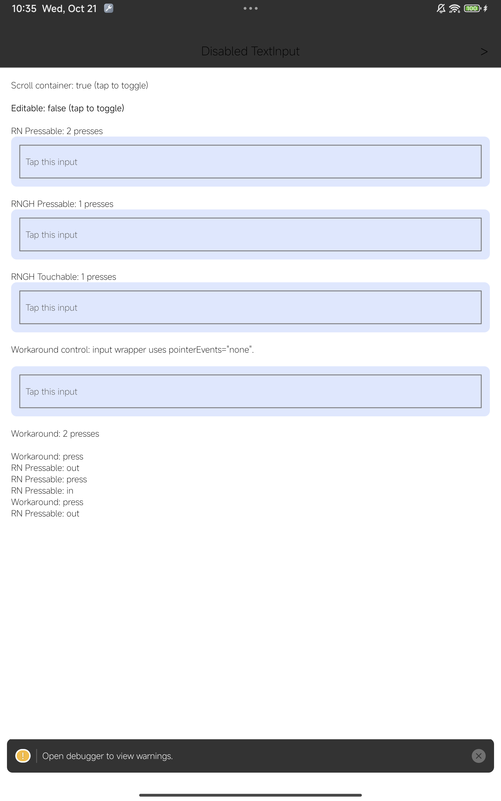
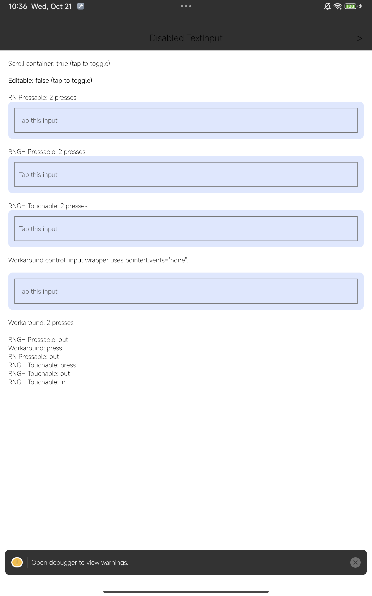

# Android disabled TextInput: reproduction and device comparison

Related issue: https://github.com/software-mansion/react-native-gesture-handler/issues/4622

## Reproduce

1. Check out RNGH commit `40ac2067a98d1b6cec23bb0efeac9454cc4ab76c`.
2. Apply `rngh-reproduction.patch` at the repository root.
3. Install its dependencies with the pinned Yarn version, then build/run `apps/basic-example` on an Android device. This checkout uses RN 0.88.0.
4. The first screen opens with `editable=false` and a ScrollView ancestor. Tap directly on each input, not the surrounding padding.
5. RN Pressable increments; RNGH Pressable and Touchable do not. The pointer-events wrapper control increments. Toggle off the ScrollView to see the baseline comparison.

`DisabledTextInput.tsx` is also included as a standalone screen. It requires React Native and RNGH v3 inside GestureHandlerRootView.

## Device comparison

Xiaomi 23046RP50C, Android 14. Each entry is the increment from one touchscreen-source tap.

| Build | Container | RN Pressable | RNGH Pressable | RNGH Touchable | Wrapper control |
| --- | --- | ---: | ---: | ---: | ---: |
| Stock RN 0.88 | View | 1 | 1 | 1 | 1 |
| Stock RN 0.88 | ScrollView | 1 | 0 | 0 | 1 |
| Disabled native touch guard | View | 1 | 1 | 1 | 1 |
| Disabled native touch guard | ScrollView | 1 | 1 | 1 | 1 |

Screenshots show cumulative totals after one tap in each container: baseline 2/1/1/2, candidate 2/2/2/2.

| Baseline | Candidate |
| --- | --- |
|  |  |

The candidate APK used the published RN 0.88 AAR with a ReactEditText subclass implementing `if (!isEnabled) return false` before `super.onTouchEvent`. `android-comparison-harness.patch` shows the diagnostic package substitution; it is not a proposed production workaround. This device comparison is not a source-built current-main RN APK.

With the candidate inside ScrollView, repeated taps each incremented once; 900 ms long presses produced long-press callbacks without an extra press; enabled inputs focused with the keyboard and no parent press; disabling them again restored parent presses; and drags from both inputs scrolled without a press.

Limitations: no fling-stop check, no exact RN 0.86.3 APK, no iOS, no RNGH-wrapped TextInput, and no alternate Pressable gesture-relation engine. Outside ScrollView, editable inputs fired the RNGH parent instead of focusing in both builds. scrcpy mouse-source clicks also differed from touchscreen events in both builds, so the results above use explicit touchscreen-source events.

The main RN source regression test is separate from this device harness. No device identifiers, remote endpoints, or credentials are needed for reproduction.
